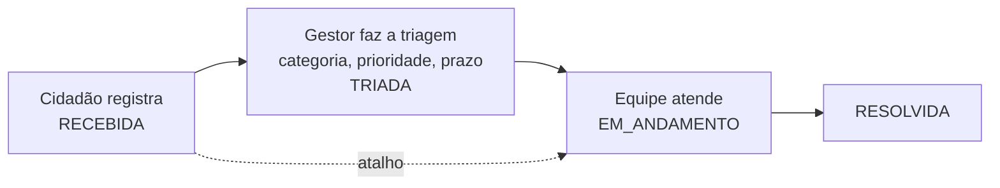

<div align="center">

# 🏘️ Lares — API .NET

**Global Solution 2026/2 · CitizenTech · Advanced Business Development with .NET**


O cidadão registra um problema na rua. A prefeitura prioriza, define o prazo e atualiza o status.<br>
O cidadão acompanha tudo pela linha do tempo da ocorrência.

</div>

---

## 📌 Sumário

- [Integrantes](#-integrantes)
- [Relação com o tema CitizenTech](#-relação-com-o-tema-citizentech)
- [Como funciona](#-como-funciona)
- [Tecnologias](#tecnologias)
- [Como rodar](#como-rodar)
- [Endpoints](#endpoints)
- [Regras de negócio](#regras-de-negócio)
- [Requisitos atendidos](#-requisitos-atendidos)

## 👥 Integrantes

| Integrante | RM |
| --- | --- |
| Felipe Bezerra Beatrici | RM 564723 |
| Max Hayashi Batista | RM 563717 |
| Henrique Cunha Torres | RM 565119 |
| Lucas da Silva Lima | RM 562118 |
| Yasmin Nathalin Miranda dos Santos | RM 561365 |

*Lares* eram os deuses romanos que protegiam os bairros; "lares" também são as casas de quem mora ali.

--- | --- |
| Felipe Bezerra Beatrici | RM 564723 |
| Max Hayashi Batista | RM 563717 |
| Henrique Cunha Torres | RM 565119 |
| Lucas da Silva Lima | RM 562118 |
| Yasmin Nathalin Miranda dos Santos | RM 561365 |

---

## 🌱 Relação com o tema CitizenTech

- **ODS 11 — Cidades e comunidades sustentáveis:** canal único entre morador e prefeitura para manutenção urbana.
- **ODS 10 — Redução das desigualdades:** qualquer bairro registra e acompanha com a mesma transparência; o filtro por bairro mostra onde a cidade atende mais devagar.
- **Valor real para o cidadão:** em vez de ligar e "torcer", ele vê o status, a prioridade, o prazo estimado e cada mudança no histórico.
- **Métricas de impacto:** tempo médio de atendimento e ocorrências resolvidas por bairro (`GET /ocorrencias?bairro=...&status=RESOLVIDA`).

---

## 🔄 Como funciona



| Papel | O que faz |
| --- | --- |
| `CIDADAO` | cria conta, registra, edita/exclui enquanto não começou o atendimento, acompanha |
| `GESTOR` | vê a fila por prioridade, faz a triagem, muda o status e ajusta o prazo |

---

## Tecnologias

| Item | Uso |
| --- | --- |
| .NET 10 · **ASP.NET Core Minimal API** (`MapGroup`) | endpoints REST |
| **EF Core 10** + **MongoDB** (`MongoDB.EntityFrameworkCore`) | persistência no MongoDB Atlas |
| **JWT Bearer** + BCrypt | autenticação e papéis `CIDADAO` / `GESTOR` |
| **OpenAPI** + Swagger UI + Scalar | documentação interativa com botão **Authorize** |
| `Microsoft.AspNetCore.RateLimiting` | rate limiting com janela fixa e HTTP 429 |
| Health Checks | `/health`, `/health/live`, `/health/ready` (ping no MongoDB) |
| **xUnit** + `WebApplicationFactory` | testes unitários e de integração **sem banco** (EF Core InMemory) |

---

## Arquitetura (camadas)

```
src/LaresApi
├── Program.cs
├── Endpoints/      Minimal API (MapGroup)
├── Services/       regras de aplicação, validações, idempotência, JWT
├── Domain/         regras de status, constantes, exceções
├── Models/         documentos do MongoDB
├── Data/           LaresDbContext (EF Core + MongoDB) e DbSeeder
├── DTOs/           contratos JSON de entrada e saída
├── Middleware/     GlobalExceptionHandler
├── HealthChecks/   api, memória e MongoDB
├── Extensions/     registro dos serviços e inicialização do banco
├── OpenApi/        esquema Bearer (botão Authorize)
└── Settings/       Jwt, LaresDatabase, RateLimiting
tests/LaresApi.Tests
├── Unit/
├── Integration/
└── Fakes/
```

### Banco de dados: MongoDB com EF Core

O requisito pede **EF Core ou Dapper**. Usamos o provider oficial **MongoDB.EntityFrameworkCore**, então o acesso é todo por `DbContext` e LINQ.

| Coleção | Conteúdo |
| --- | --- |
| `usuarios` | nome, email, senhaHash (BCrypt), papel |
| `categorias` | codigo, nome, descricao, prazoPadraoDias (7 no seed) |
| `ocorrencias` | dados da ocorrência + **histórico embutido** (lista de mudanças de status) |
| `chaves_idempotencia` | respostas guardadas por Idempotency-Key |

Modelagem de documento: o histórico fica **dentro** da ocorrência (`OwnsMany`), e o nome do cidadão e da categoria são copiados para a ocorrência. Assim o detalhe com a linha do tempo vem numa única leitura. Os ids são ObjectId (24 caracteres).

### Triagem pelo gestor

A prioridade e o prazo são definidos pelo gestor no `PATCH /ocorrencias/{id}/status`:

- ao **triar** (sair de `RECEBIDA`), o gestor informa `prioridade` (`BAIXA`, `MEDIA`, `ALTA`) e `categoria` (código, ex.: `BURACO`);
- se não mandar `prazoEstimadoDias`, a API usa o **prazo padrão da categoria** (BURACO = 15 dias);
- em qualquer mudança seguinte ele pode ajustar prioridade, prazo e categoria.

---

## Como rodar

Pré-requisitos: [.NET SDK 10](https://dotnet.microsoft.com/download) e um cluster no [MongoDB Atlas](https://www.mongodb.com/cloud/atlas) (o plano gratuito M0 serve).

```bash
git clone https://github.com/SEU-USUARIO/LaresApi-NET.git
cd LaresApi-NET
dotnet restore

cd src/LaresApi
dotnet user-secrets set "LaresDatabase:ConnectionString" "mongodb+srv://<usuario>:<senha>@<cluster>.mongodb.net/?appName=Lares"
dotnet user-secrets set "Jwt:Chave" "<texto aleatório com 32+ caracteres>"
cd ../..

dotnet run --project src/LaresApi
```

Abra **http://localhost:5102/swagger** (ou `/scalar`). Na primeira subida a API cria o banco `LaresDb`, as coleções, o gestor, o cidadão de teste e as 7 categorias.

Em produção (Azure), os segredos vão em variáveis de ambiente:

| Variável | Valor |
| --- | --- |
| `LaresDatabase__ConnectionString` | connection string do Atlas |
| `Jwt__Chave` | texto aleatório com 32+ caracteres |

**Sem connection string configurada, a API roda com um banco em memória**: basta `dotnet run --project src/LaresApi` para testar todos os endpoints. Para usar o MongoDB do grupo, peça a connection string a um integrante e configure com `dotnet user-secrets` como acima. Ela não fica no repositório por segurança.

### Testes

```bash
dotnet test
```

Os testes não precisam de MongoDB: o `CustomWebApplicationFactory` sobe a API com o provider InMemory do EF Core, então rodam na CI do Azure DevOps.

---

## Usuários de teste (seed)

| Papel | E-mail | Senha |
| --- | --- | --- |
| GESTOR | `gestor@lares.com` | `Gestor@123` |
| CIDADAO | `cidadao@lares.com` | `Cidadao@123` |

No Swagger: `POST /auth/login` → copie o `token` → **Authorize** → cole o token.

---

## Endpoints

| Método e rota | Quem | Para quê |
| --- | --- | --- |
| `POST /auth/registro` | público | cadastro de cidadão |
| `POST /auth/login` | público | devolve o token (24 h) |
| `GET /usuarios/me` | logado | dados do usuário |
| `GET /categorias` | logado | categorias e prazo padrão |
| `POST /ocorrencias` | CIDADAO | registrar (idempotente com `Idempotency-Key`, 5/min) |
| `GET /ocorrencias/minhas?page&size` | CIDADAO | minhas ocorrências |
| `GET /ocorrencias?bairro&status&sort&page&size` | logado | busca; fila do gestor: `status=RECEBIDA&sort=prioridade` |
| `GET /ocorrencias/{id}` | logado | detalhe com histórico |
| `PUT /ocorrencias/{id}` | CIDADAO dono | editar (só `RECEBIDA` ou `TRIADA`) |
| `DELETE /ocorrencias/{id}` | CIDADAO dono | excluir (só `RECEBIDA` ou `TRIADA`) |
| `PATCH /ocorrencias/{id}/status` | GESTOR | mudar status, **definir prioridade e prazo**, corrigir categoria |
| `GET /health` · `/health/live` · `/health/ready` | público | monitoramento (inclui ping no MongoDB) |

**Códigos:** 200, 201, 204, 400 (validação), 401 (sem token), 403 (papel errado ou não é o dono), 404, 409 (status não permite), 422 (Idempotency-Key reaproveitada com outro corpo), 429 (limite de requisições).

### Exemplos

```jsonc
// PATCH /ocorrencias/{id}/status  (gestor faz a triagem)
{ "status": "TRIADA", "categoria": "BURACO", "prioridade": "ALTA", "comentario": "Perto de escola" }
// → prazoEstimadoDias = 15 (padrão de BURACO)

// PATCH /ocorrencias/{id}/status  (gestor envia equipe e ajusta o prazo)
{ "status": "EM_ANDAMENTO", "prazoEstimadoDias": 10, "comentario": "Equipe enviada" }

// Erro (todas as respostas de erro)
{ "status": 400, "erro": "Bad Request", "mensagem": "Dados inválidos",
  "campos": { "descricao": "não pode ser vazio" } }
```

Mais exemplos em `src/LaresApi/LaresApi.http`.

---

## Regras de negócio

**Status:** `RECEBIDA` → `TRIADA` → `EM_ANDAMENTO` → `RESOLVIDA`, com o atalho `RECEBIDA` → `EM_ANDAMENTO`. Qualquer outra transição devolve **409**. Toda mudança, inclusive a abertura, grava uma linha no histórico embutido na ocorrência.

**Cidadão** só edita ou exclui a própria ocorrência enquanto ela está `RECEBIDA` ou `TRIADA`.

**Idempotência (`POST /ocorrencias`):** com o header `Idempotency-Key`, a API reserva a chave na coleção `chaves_idempotencia` **antes** de criar a ocorrência e guarda a resposta. Repetir com a mesma chave e o mesmo corpo devolve a **mesma resposta** (header `Idempotency-Replayed: true`) sem criar outro registro; a mesma chave com outro corpo devolve **422**; se a primeira ainda está processando, **409**. A chave vale por usuário e expira em 24 h.

**Rate limiting:** janela fixa. `POST /ocorrencias`: 5 por minuto **por usuário**. `/auth/*`: 10 por minuto por IP (protege contra força bruta no login). Acima disso: **429** com `Retry-After`.

**Health checks:** `api` (processo de pé), `memoria` (Degraded acima de 512 MB) e `mongodb` (ping no MongoDB Atlas). `/health/live` só verifica o processo; `/health/ready` verifica o banco.

---

## ✅ Requisitos atendidos

| # | Requisito | Onde está |
| --- | --- | --- |
| 01 | Minimal API RESTful, validações, códigos HTTP, OpenAPI/Swagger | `Endpoints/`, `Services/Validacoes.cs`, `/swagger` |
| 02 | Autenticação e autorização com JWT | `Services/TokenService.cs`, políticas `SomenteCidadao` e `SomenteGestor` |
| 03 | Idempotência | header `Idempotency-Key`, `Services/Idempotencia.cs` |
| 04 | Rate limiting com HTTP 429 | `AddRateLimiter` em `Extensions/ServiceCollectionExtensions.cs` |
| 05 | Testes unitários e de integração com xUnit | `tests/LaresApi.Tests` (76 casos) |
| 06 | Health checks da API, banco e serviços externos | `/health`, `/health/live`, `/health/ready` |

Tecnologias obrigatórias: **ASP.NET Core Minimal API** e **EF Core** (provider MongoDB).

---

## Uso de IA

O Lares usa IA na **API Java** (serviço Python/FastAPI de triagem e Spring AI para o resumo ao cidadão). Na **API .NET** a triagem é **feita pelo gestor**: ele define prioridade, categoria e prazo no `PATCH /ocorrencias/{id}/status`, e a API sugere o prazo padrão da categoria. Assim a .NET não depende de um serviço externo que dorme no plano gratuito do Render.

---

## Azure DevOps

Depois da importação no Azure Repos, toda mudança entra na `main` via PR ligado a um work item; em seguida o GitHub é atualizado:

```bash
git remote add azure <URL do Azure Repos>
git push azure main
git push origin main
```
